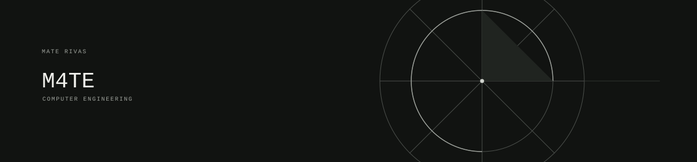

I'm Mate Rivas, a Computer Engineering student at the National University of La Plata (UNLP), Argentina. My interests include software engineering, Linux and systems, embedded computing, digital design, and offensive security.

**Technologies used across my projects:** Java, Python, and Django.

## Selected projects

- [**Relievo**](https://github.com/M4teee/Relievo) — A planning-stage project to generate 3D-printable tactile frames combining a window for a physical model with Spanish text and Braille; geometry and tactile readability remain to be validated.
- [**Introducción al Diseño Lógico — 4-bit ALU**](https://github.com/M4teee/Introduccion-al-Dise-o-Logico-2026) — A Quartus II schematic-based team project implementing an 8-operation ALU with accumulator and auxiliary registers, arithmetic and logic operations, and V/N/Z/C status flags.
- [**Taller de Lenguajes II — Streaming Platform**](https://github.com/M4teee/Taller-de-Lenguajes-II-2026) — A Java coursework team project modelling a streaming platform for music, podcasts, and audiobooks, with playlists, likes, and a simulated playback queue.
- [**Ingeniería en Software 2026 — Delivery Management System**](https://github.com/M4teee/Ingenieria-en-Software-2026) — A Python and Django coursework team project for order tracking and delivery workflows. Manual assignment works; automatic assignment remains pending.

